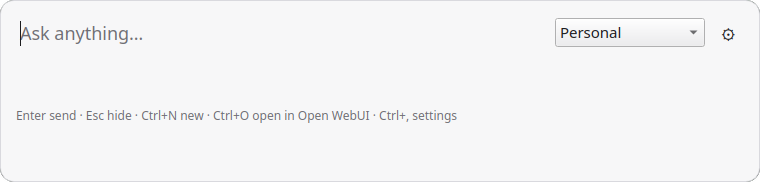
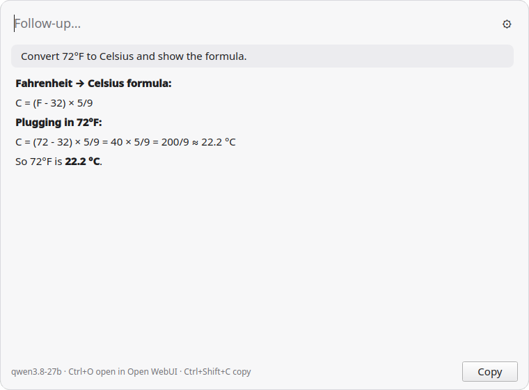
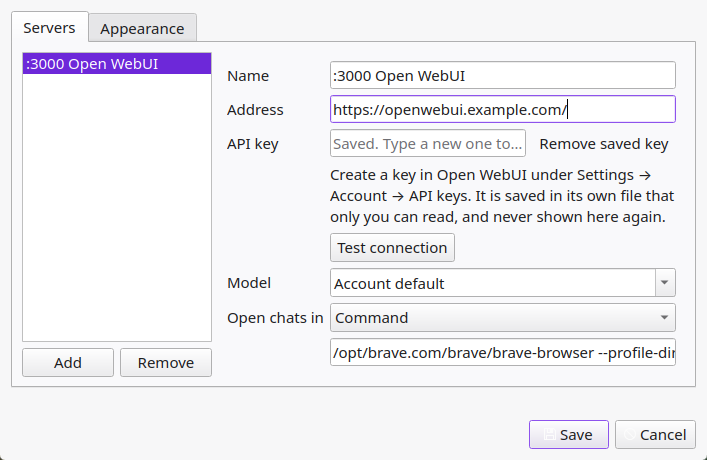

# owui-pop

[](https://github.com/estrella159/owui-pop/actions/workflows/ci.yml)

A quick-ask pop-up for [Open WebUI](https://github.com/open-webui/open-webui) on the Linux desktop.
Press a key, type a question, read the answer in place. Follow-ups continue the same chat, and one key
opens it in Open WebUI to carry on there.

It is a small native app (Python and Qt 6), not a browser window, so it opens instantly and stays out
of the way.

<p align="center"></p>
<p align="center"></p>

## What it does

- **Answers in place.** The answer streams into the pop-up. Scroll up to read while it writes: the view
  only follows the end while you are at the end.
- **Runs the turn like the web page.** The chat is saved in Open WebUI and the server runs the model's
  tools (web search, knowledge, your own tools), so answers match what you'd get in the browser, and
  every chat is in your Open WebUI history.
- **Several servers.** Add as many Open WebUI servers as you like and switch with the menu next to the
  question.
- **Settings window** for servers, API keys (with a connection test), the model, how chats open in the
  full app, theme (system, light, dark), text size, width and position.
- **Keyboard first.**

| Key | Does |
|---|---|
| Enter | Send, or ask a follow-up |
| Esc | Stop waiting for an answer, or hide |
| Ctrl+N | New chat |
| Ctrl+O | Open the chat in Open WebUI |
| Ctrl+Shift+C | Copy the last answer |
| Ctrl+, | Settings |

Drag any empty part of the pop-up (its edges or the status line) to move it.

<p align="center"></p>

## Install

Needs Python 3.10 or newer. [pipx](https://pipx.pypa.io) is recommended.

```sh
git clone https://github.com/estrella159/owui-pop
cd owui-pop
./install.sh
```

Or straight from the repository: `pipx install git+https://github.com/estrella159/owui-pop`.

Then run `owui-pop`. On first run Settings opens: add your Open WebUI address and an API key, press
**Test connection**, and Save.

**A key to open it.** Bind the command `owui-pop` to a key in your desktop's keyboard settings. On KDE
Plasma: System Settings → Shortcuts → Add New → Command. On GNOME: Settings → Keyboard → Custom
Shortcuts. Running `owui-pop` again shows the pop-up that is already running, so it opens instantly.
`owui-pop --settings` opens Settings.

**An API key.** In Open WebUI: Settings → Account → API keys. If API keys are switched off there, an
admin can enable them in Admin Settings → General.

## Position on Wayland

On Wayland an app may not place its own windows, the compositor does. owui-pop handles this:

- **KDE Plasma:** Settings → Appearance → Position writes one KWin window rule for the pop-up's own
  window (`owui-pop`) and reloads KWin. It touches no other rule, and "Let the desktop decide" removes it.
- **X11:** the pop-up moves itself.
- **Other Wayland desktops:** the desktop places it, and the setting is unavailable.

## How it works

Each question is saved as a chat in Open WebUI, then sent to `/api/chat/completions` with that chat's
id, the same way the web page sends it, including the tools attached to the model. Open WebUI runs the
model and its tools and writes the answer into the chat. The pop-up reads the chat twice a second to
show the answer as it grows, and hides tool-call and reasoning blocks.

The model is the one you pick in Settings, or by default the account's own default model (the user
setting, then the admin default, then the first model).

Tested with Open WebUI 0.13.

## Files and privacy

Everything lives in `~/.config/owui-pop/`:

- `config.json`: servers (without keys) and preferences.
- `keys/<server>`: one API key per server, in a folder only you can open, each file readable only by you.

Keys are never written to `config.json` and never shown again in Settings. The pop-up talks only to
the Open WebUI servers you add. An Open WebUI API key acts as your account, so treat it like a password.

## Development

```sh
pip install -e ".[test]"
pytest
python -m owui_pop
```

The Open WebUI client (`client.py`) and the settings (`config.py`) have no Qt in them and are tested
against a fake server.

## Licence

MIT
